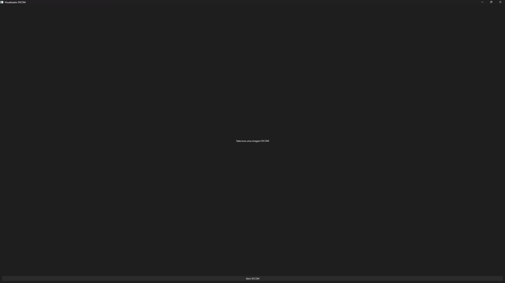
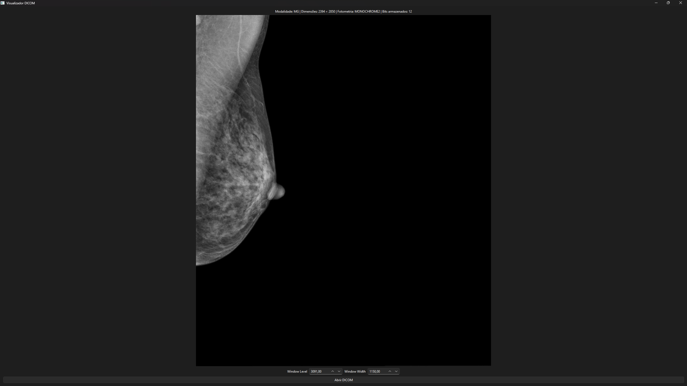
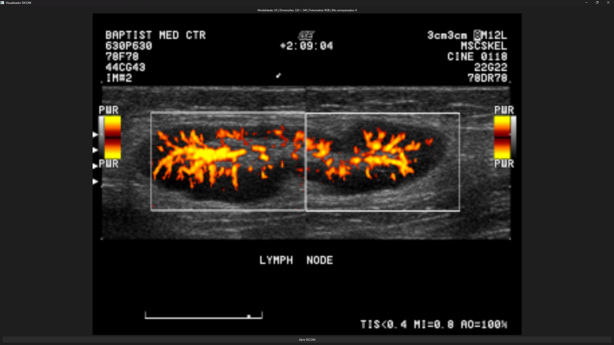

# Visualizador DICOM

Aplicação desktop em C++17 e Qt Widgets para abrir e visualizar imagens DICOM
monocromáticas. A imagem é centralizada e acompanha o tamanho da janela,
preservando a proporção e a orientação dos pixels do arquivo.

## Demonstração

### Tela inicial



### Imagem monocromática



### Imagem RGB



[Amostra usada no teste](assets/anonymized_lymph_node.dcm), distribuída pelo [projeto pydicom](https://pydicom.github.io/pydicom/stable/reference/examples.html) como `examples_rgb_color.dcm`.

## Ambiente testado

- Windows x64
- Visual Studio 2022 com o compilador MSVC x64
- Qt 6.12.0, kit Desktop MSVC 2022 64-bit
- CMake 3.21 ou superior
- DCMTK 3.7.1, instalada pelo vcpkg

## Configuração e compilação

1. Instale o compilador C++ do Visual Studio 2022, o Qt Creator, o CMake
   e o kit Qt Desktop MSVC 2022 64-bit.
2. Para instalar a DCMTK com uma instalação nova do vcpkg, execute no PowerShell:

   ```powershell
   git clone https://github.com/microsoft/vcpkg.git "$HOME\vcpkg"
   & "$HOME\vcpkg\bootstrap-vcpkg.bat"
   & "$HOME\vcpkg\vcpkg.exe" install dcmtk:x64-windows
   ```

3. Abra o `CMakeLists.txt` no Qt Creator e selecione o kit
   **Desktop Qt 6.12.0 MSVC 2022 64-bit**.
4. Em **Projects → Build Settings → CMake → Initial Configuration**,
   adicione ao campo **Additional CMake options** a opção abaixo.
   Substitua `<usuario>` pelo nome da sua pasta de usuário no Windows.
   Se instalou o vcpkg em outro local, ajuste o caminho.

   ```text
   -DCMAKE_TOOLCHAIN_FILE=C:/Users/<usuario>/vcpkg/scripts/buildsystems/vcpkg.cmake
   ```

5. Clique em **Re-configure with Initial Parameters**. Quando a configuração
   terminar, pressione **Ctrl+R** para compilar e executar.

## Uso

Clique em **Abrir DICOM** e selecione um arquivo `.dcm`. Ao carregar a imagem,
o visualizador exibe a modalidade, as dimensões, a interpretação fotométrica
e a quantidade de bits armazenados.

Use **Window Level** para ajustar o centro do intervalo de intensidades e
**Window Width** para ajustar sua largura. Ao digitar um valor, pressione
**Enter** para aplicá-lo.

O contraste inicial usa o primeiro ajuste de janela definido no arquivo,
quando disponível. Caso contrário, o visualizador usa os valores mínimo e
máximo dos pixels. O módulo `dcmjpeg` da DCMTK permite abrir a amostra do
teste, comprimida com JPEG Lossless.

## Verificação manual

- Abertura da amostra `assets/anonymized_mamo.dcm`, de 2394 × 2850 pixels.
- Abertura da amostra colorida `assets/anonymized_lymph_node.dcm`, com exibição
  em RGB e controles de Window Level e Window Width ocultos.
- Comparação da imagem exibida com os pixels decodificados da amostra,
  confirmando a orientação tanto na janela normal quanto na maximizada.
- Alteração de Window Level e Window Width com atualização da imagem exibida.
- Redimensionamento da janela com a imagem inteira visível e proporcional.
- Seleção de um arquivo de texto pelo filtro **Todos os arquivos**,
  seguida da exibição de uma mensagem de erro e da abertura bem-sucedida
  de um DICOM válido.